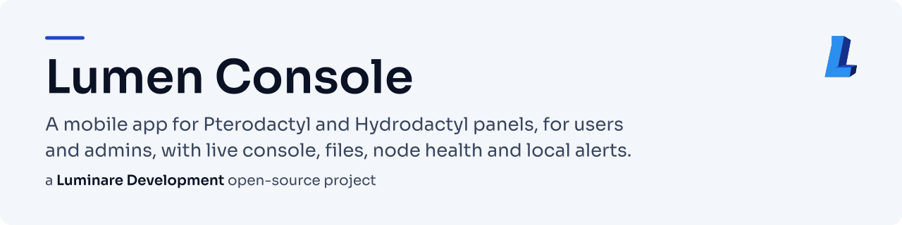

<!-- header:begin: brand-repos 0.1.0, variant studio, files in docs/brand/; the project-page sync drops this block -->
<picture>
  <source media="(prefers-color-scheme: dark)" srcset="docs/brand/readme-header-dark.svg">
  <source media="(prefers-color-scheme: light)" srcset="docs/brand/readme-header-light.svg">
  
</picture>

<!-- byline:studio -->
*a [Luminare Development](https://luminare.tech/open-source/lumen-console/) open-source project*
<!-- /byline:studio -->
<!-- byline:personal
*by ItsPaulAT · [project page](https://luminare.tech/open-source/lumen-console/)*
/byline:personal -->

<!-- header:end -->

# lumen-console

A mobile app for Pterodactyl and Hydrodactyl panels, for regular users and for admins: servers
with live state, power, the live console, files, backups, schedules, startup variables, admin
tools for users, servers and nodes, Wings node health and local alerts. Built with Expo for
Android, iOS and the web, in the Lumen look.

Not affiliated with or endorsed by the Pterodactyl project or the Blueprint project. Pterodactyl
and Hydrodactyl are named only to describe what the app works with; Pterodactyl is a registered
trademark of Dane Everitt.

[](https://github.com/luminare-dev/lumen-console/actions/workflows/ci.yml)
[](LICENSE)

<!-- screenshots:begin -->
| Dark | Light |
|---|---|
|  |  |
|  |  |
|  |  |
|  |  |
|  |  |
|  |  |
|  |  |
|  |  |

Screenshots from CI (the `screenshots` artifact of the `ci` workflow): the web build at phone
size against the mock panel, with invented data.
<!-- screenshots:end -->

## Why

Existing apps for these panels cover the client side (console, files, backups). This one also
covers the admin side (the application API), node health straight from Wings, alerts without
keeping the app open, and Hydrodactyl, which moves its server endpoints below the daemon type.

## Features

**For every user** (client API key, `ptlc_…` or `hydro_…`):

- Several panels; https only; the key is checked before it is saved; certificate, key, IP,
  permission and reachability problems are explained in plain words.
- Servers with state, CPU and memory; search.
- Server screen: CPU, memory, disk and network against the limits, refreshed every 10 seconds;
  start, restart, stop and kill, each confirmed.
- Live console over the node's WebSocket: log history, output, commands, live stats, token
  renewal before it expires.
- Files: browse, view and edit text files, rename, new folder, delete (confirmed), download and
  upload through the panel's signed node links.
- Backups: list with state, create, download, restore with optional wipe (confirmed).
- Schedules (run now, confirmed), databases, network allocations, startup variables (edit the
  editable ones), subusers, the account and its API keys.

**For admins** (plus an application key, `ptla_…` or `hydro_…`):

- Users: list, search, create, edit; suspend or unsuspend all servers of a user (the panel has no
  account suspension).
- All servers: search, details, suspend/unsuspend, reinstall (confirmed by typing the name).
- Nodes: allocated memory and disk, allocation usage, maintenance, a Wings probe, and Wings' own
  system information with the node's daemon token, read from the panel or pasted. Locations;
  nests and eggs (read-only).

**Alerts**: server stopped or crashed, server or node unreachable, disk and memory thresholds,
node over-allocation and failed backups, checked in the background on Android and iOS with local
notifications, switchable per panel ([how and limits](docs/alerts.md)). No server of ours is
involved; a push relay is a planned follow-up.

**Hydrodactyl**: detected through its version endpoint; the daemon-type routes, the stored
resource history and the panel host status are used. Its other additions are listed in
[docs/api.md](docs/api.md).

**Lumen look** in dark and light, from the shared Lumen design tokens: pick a preset or import a
token file from any Lumen theme. English and German.

Every endpoint used, and what is not used and why, is in [docs/api.md](docs/api.md).

## Security

- Keys and pasted daemon tokens are stored with `expo-secure-store` (iOS Keychain, Android
  Keystore), readable after the first unlock so the background check works. Daemon tokens read
  from the panel stay in memory only. Nothing is written to app storage or logs, and a daemon
  token is sent only to its own node.
- On the **web** keys live only in the browser tab's session storage and are gone when the tab is
  closed; the app says so. Panels and Wings normally do not allow other web origins (CORS and the
  console's origin check), so the web build is mainly a preview and the test target.
- Only `https://` panels and nodes are used, redirects are refused, certificate errors are not
  skipped, and the console refuses `ws://`.
- Use a client key limited to the IP addresses you connect from, and give an application key only
  the permissions you use from the phone. Treat both like passwords.

## Development

Requirements: Node.js 22 (`.nvmrc`), Python 3 for the repository checks.

```bash
npm ci
npm run web          # Expo dev server in the browser
npm run check        # type check, Jest unit tests, web build
npx playwright install chromium
npm run e2e          # Playwright against the web build, the mock panel and the mock console socket
SCREENSHOTS=1 npx playwright test e2e/screenshots.spec.ts
python3 -m unittest discover -s tests -v   # repository checks
```

- `src/api/`: typed clients for the Client API, the Application API, the Wings probe and the
  console WebSocket session.
- `src/mock/`: an in-memory panel (both flavours), node and console socket with invented data
  (tests only).
- `src/alerts/`: alert rules, the check of all panels, the background task.
- `src/theme/lumen/`: the shared Lumen token core, a locked copy of
  [lumen-hydrodactyl-theme](https://github.com/luminare-dev/lumen-hydrodactyl-theme)'s
  (`shared.lock`, checked by `scripts/check_shared.py` in CI).
- No real panel, node or key is used anywhere in the tests.
- The lockfile is written on a runner by the manual `lockfile` workflow.

Native builds use EAS; what is needed for them is in [docs/builds.md](docs/builds.md).

## Licence

[MIT](LICENSE). The licence covers the code only: the project name, logo, header images
and `docs/brand/` are not licensed (see [NOTICE](NOTICE)).

<!-- byline:studio -->
*a [Luminare Development](https://luminare.tech/open-source/lumen-console/) open-source project*
<!-- /byline:studio -->
<!-- byline:personal
*by ItsPaulAT · [project page](https://luminare.tech/open-source/lumen-console/)*
/byline:personal -->
